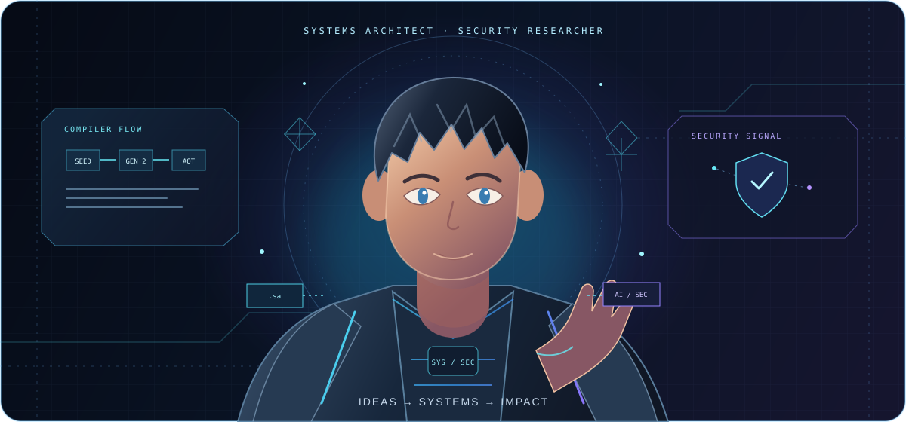
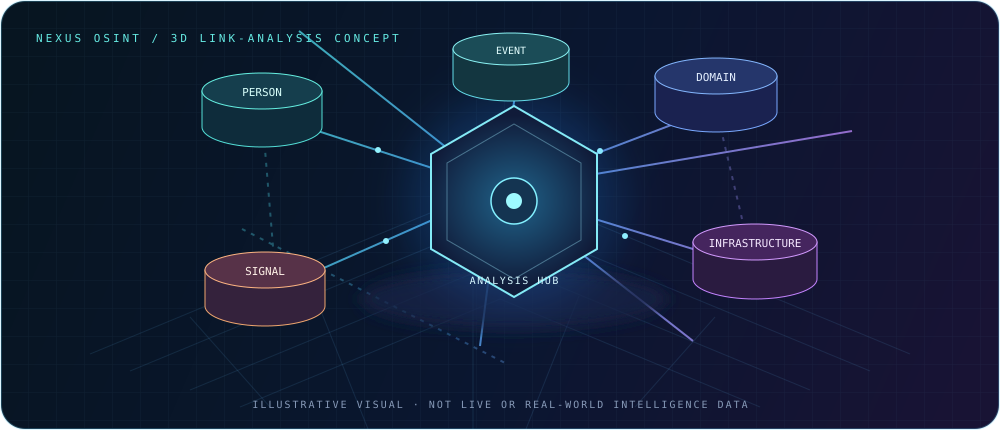
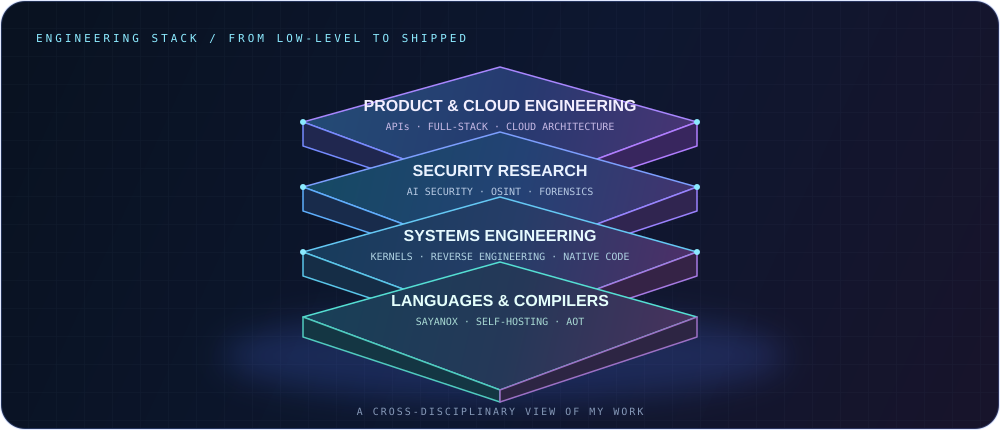
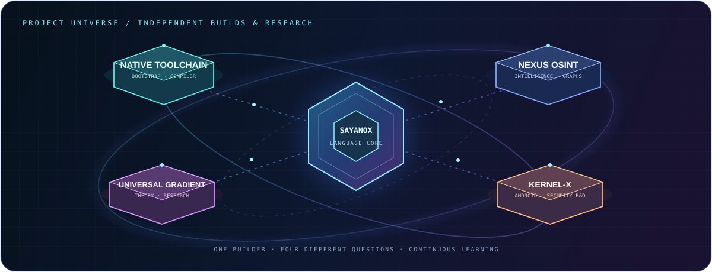
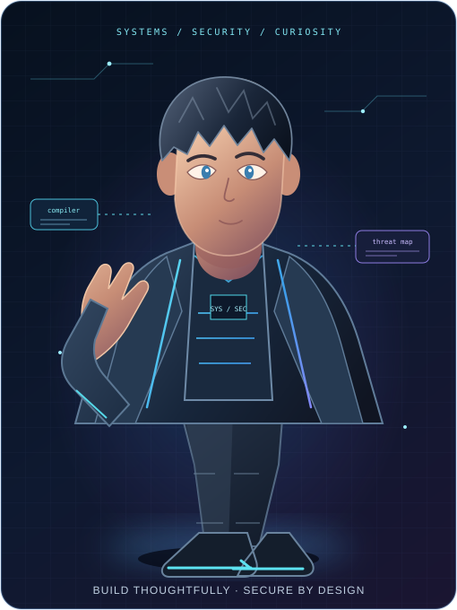
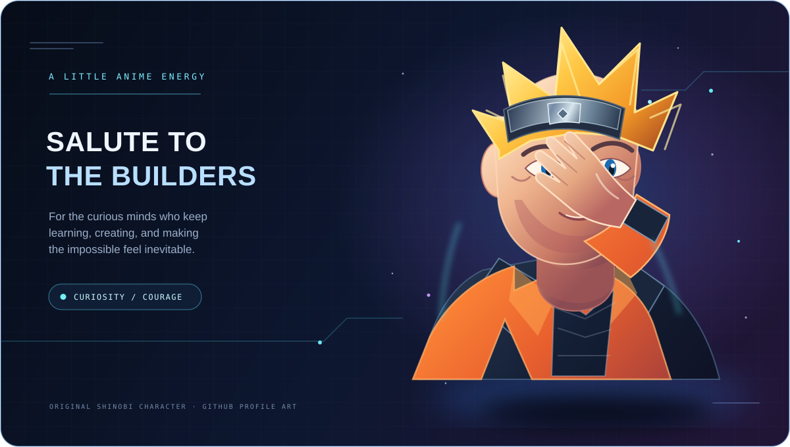
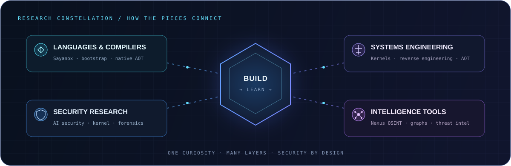
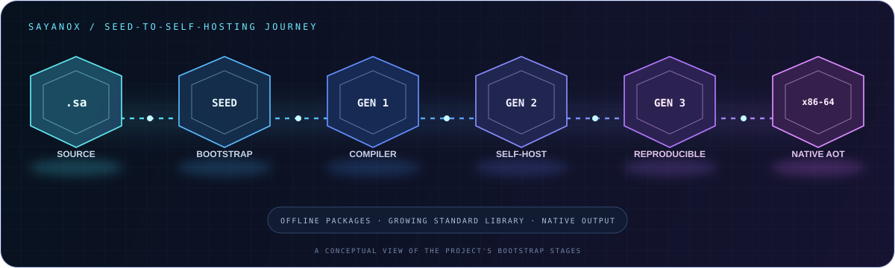

<div align="center">



<br />

[](https://git.io/typing-svg)

[](https://github.com/sayan9168)
[](https://github.com/sayan9168)
[](https://orcid.org/0009-0002-3491-6570)

[](https://sayan9168.github.io)
[](https://www.linkedin.com/in/sayan-mahata-a8b321391)
[](https://instagram.com/_sayyyyan)
[](mailto:sm6881164@gmail.com)

<br />

[ABOUT](#about) &nbsp; · &nbsp; [PROJECTS](#projects) &nbsp; · &nbsp; [3D VISUALS](#visual-gallery) &nbsp; · &nbsp; [SKILLS](#skills) &nbsp; · &nbsp; [GITHUB ACTIVITY](#github-activity) &nbsp; · &nbsp; [CONTACT](#contact)

</div>

---

<a id="about"></a>
## `whoami` · A little about me

I'm **Sayan Mahata** — also known as **Sayan The Researcher** — a systems architect and security researcher from **Medinipur, West Bengal, India**. I founded **Sayanox Private Limited** and created **Sayanox**, an original systems programming language with a self-hosting compiler.

My work lives where low-level systems, security, and ambitious ideas meet. I like understanding how things work all the way down, then building something useful from that understanding.

> **My guiding principle:** Security is not a feature. It is the foundation.

### 🔎 Recruiter quick view

Open to conversations about **systems and compiler engineering**, **security research / product security**, and **AI- or OSINT-enabled tools**. I value roles where I can investigate deeply, build end-to-end, and keep security in the design—not bolt it on later.

| Role conversation | Project evidence |
|:---|:---|
| **Systems / compiler engineering** | [Sayanox](https://github.com/sayan9168/sayanox) — original `.sa` language, self-hosting compiler, bootstrap, native x86-64 AOT |
| **Security research / engineering** | [Kernel-X-Unlocker](https://github.com/sayan9168/Kernel-X-Unlocker) — educational Android kernel security research |
| **OSINT / intelligence tooling** | [Nexus OSINT](https://github.com/sayan9168/nexus-osint) — AI-native OSINT and 3D link-analysis platform |

<div align="center">

[](mailto:sm6881164@gmail.com?subject=Opportunity%20for%20Sayan%20Mahata)
[](https://www.linkedin.com/in/sayan-mahata-a8b321391)

</div>

<details>
<summary><b>⚡ Current focus &amp; working principles</b></summary>
<br />

- Designing **Sayanox** (`.sa`): a self-hosting compiler, seed-to-gen3 bootstrap, native x86-64 AOT, offline packages, and a growing standard library.
- Exploring **AI-native security**, autonomous testing, threat intelligence, and digital forensics.
- Researching **kernels, reverse engineering, exploit development**, and systems programming.
- Building **full-stack products and cloud architecture** with security in mind.
- Open to research collaborations, systems roles, open-source work, consulting, and technical speaking.

</details>

---

<a id="projects"></a>
## ✦ Selected builds & research

<table>
<tr>
<td width="50%" valign="top">

### 🦅 Sayanox
**An original systems programming language**

A `.sa` language with a self-hosting compiler, native x86-64 AOT, offline packages, and a growing standard library. Built from the ground up.

`LANGUAGE DESIGN` `COMPILERS` `NATIVE AOT`

[](https://github.com/sayan9168/sayanox/stargazers) [](https://github.com/sayan9168/sayanox/commits)

[](https://github.com/sayan9168/sayanox)

[](https://github.com/sayan9168/sayanox/actions/workflows/ci.yml)
[](https://github.com/sayan9168/sayanox/actions/workflows/full-bootstrap.yml)

</td>
<td width="50%" valign="top">

### 🌐 Nexus OSINT
**AI-native OSINT &amp; 3D link analysis**

A platform for connecting open-source intelligence and visualizing relationships as an interactive graph.

`OSINT` `THREAT INTEL` `3D VISUALIZATION`

[](https://github.com/sayan9168/nexus-osint/stargazers) [](https://github.com/sayan9168/nexus-osint/commits)

[](https://github.com/sayan9168/nexus-osint)

</td>
</tr>
<tr>
<td width="50%" valign="top">

### 🔬 Universal Gradient Theory
**A mathematical framework**

Original research on universal thermal gradients and deep-space analysis, with a Python package and DOI on Zenodo.

`RESEARCH` `PHYSICS` `PYTHON`

[](https://github.com/sayan9168/Sayan-Universal-Gradient-Theory/stargazers) [](https://github.com/sayan9168/Sayan-Universal-Gradient-Theory/commits)

[](https://github.com/sayan9168/Sayan-Universal-Gradient-Theory)

</td>
<td width="50%" valign="top">

### 🔓 Kernel-X-Unlocker
**Android kernel security research**

An educational research tool for Android file-based encryption and screen-lock analysis.

`ANDROID` `KERNEL` `SECURITY RESEARCH`

[](https://github.com/sayan9168/Kernel-X-Unlocker/stargazers) [](https://github.com/sayan9168/Kernel-X-Unlocker/commits)

[](https://github.com/sayan9168/Kernel-X-Unlocker)

</td>
</tr>
</table>

<details>
<summary><b>⌨️ Peek at Sayanox syntax &amp; native build command</b></summary>
<br />

A real, minimal example from the language repository:

```sayanox
hold name = "Sayanox"
show "Hello"
show name
```

Build and run the native example from the repository root:

```sh
./sx target native
./selfhost/native_aot examples/hello.sa hello
./hello
```

[Browse the examples](https://github.com/sayan9168/sayanox/tree/main/examples) · [Read the full project documentation](https://github.com/sayan9168/sayanox#readme)

</details>

<a id="visual-gallery"></a>
### 🧊 3D visualization gallery

<div align="center">

<table>
<tr>
<td width="50%" valign="top">

</td>
<td width="50%" valign="top">

</td>
</tr>
</table>

<sub>Original concept artwork: the network is illustrative, not live intelligence data; the stack is a map of engineering domains, not a product architecture diagram.</sub>

<br /><br />



<sub>Project orbit is a visual index—not a popularity, performance, or activity chart.</sub>

### 🧑‍💻 Cinematic character concepts

<table>
<tr>
<td width="34%" valign="top">

</td>
<td width="66%" valign="top">

</td>
</tr>
</table>

<sub>Original concept illustrations—not photographs, personal likenesses, official Naruto artwork, or live 3D scenes.</sub>

### ◈ Holographic icon kit

<div align="center">

</div>

</div>

<div align="center">

[](https://github.com/sayan9168?tab=repositories)

</div>

### ✧ The systems map

A quick view of the connected problem spaces I work across—from compiler internals to security research and intelligence tooling.

<div align="center">

</div>

<details>
<summary><b>🧱 Open the Sayanox compiler pipeline</b></summary>
<br />

The compiler bootstrap progresses from the seed through gen1, gen2, and gen3 into native x86-64 AOT, alongside offline packages and a growing standard library.

<div align="center">

</div>

</details>

### 🧭 Research &amp; engineering lanes

| Domain | What I explore | What I build |
|:---|:---|:---|
| **Languages &amp; compilers** | Parsing, bootstrapping, native code generation | Sayanox and compiler tooling |
| **Systems engineering** | Kernels, reverse engineering, low-level performance | Native, close-to-the-metal software |
| **Security research** | Threat modeling, AI security, digital forensics | Security-first tools and research prototypes |
| **Intelligence platforms** | OSINT, graph analysis, threat intelligence | Tools for exploring connected information |
| **Cloud &amp; application engineering** | APIs, infrastructure, full-stack architecture | Deployable, maintainable applications |

---

<a id="skills"></a>
## ⌘ Tools of the trade

<div align="center">

**Languages &amp; systems**<br />


**Security &amp; research**<br />


**Cloud, DevOps &amp; AI**<br />


</div>

---

<a id="github-activity"></a>
## ◈ GitHub signal

<div align="center">

<a href="https://github.com/anuraghazra/github-readme-stats"></a>
<a href="https://github.com/anuraghazra/github-readme-stats"></a>

<br /><br />

<a href="https://git.io/streak-stats"></a>

<br /><br />

<a href="https://github.com/sayan9168"></a>

<br /><br />

<a href="https://github.com/ryo-ma/github-profile-trophy"></a>

</div>

### 🐍 Contribution trail

This profile repository includes a GitHub Actions workflow that refreshes the contribution snake. Once the workflow has run, the animated contribution trail appears below.

<div align="center">

<picture>
  <source media="(prefers-color-scheme: dark)" srcset="https://raw.githubusercontent.com/sayan9168/sayan9168/output/github-contribution-grid-snake-dark.svg" />
  <source media="(prefers-color-scheme: light)" srcset="https://raw.githubusercontent.com/sayan9168/sayan9168/output/github-contribution-grid-snake.svg" />
  
</picture>

</div>

---

<a id="contact"></a>
## ◉ Beyond the code

<div align="center">

### Sayanox Private Limited

**Founder &amp; Lead Engineer — Sayan Mahata**<br />
Building secure infrastructure, programming languages, and AI-driven security systems.

`SECURITY ENGINEERING` &nbsp; `AI / ML` &nbsp; `COMPILER DESIGN` &nbsp; `THREAT INTELLIGENCE`

</div>

**Certifications**<br />
🎓 Cisco Certified Ethical Hacker (CEH) · 🏛️ Cisco<br />
☁️ AWS AI Cloud Practitioner · 🏛️ Amazon Web Services

**Open to:** security research · systems engineering · AI/ML security · open-source collaboration · consulting · speaking

---

<div align="center">

### Let's build something thoughtful.

Security research, language design, systems engineering—or a technically interesting challenge? **[Get in touch](mailto:sm6881164@gmail.com).**

<br />

[](https://github.com/sayan9168)
[](https://sayan9168.github.io)
[](mailto:sm6881164@gmail.com)

<br /><br />

<sub>© 2026 Sayan Mahata · Sayan The Researcher · Made with curiosity in West Bengal, India 🇮🇳</sub>

</div>
